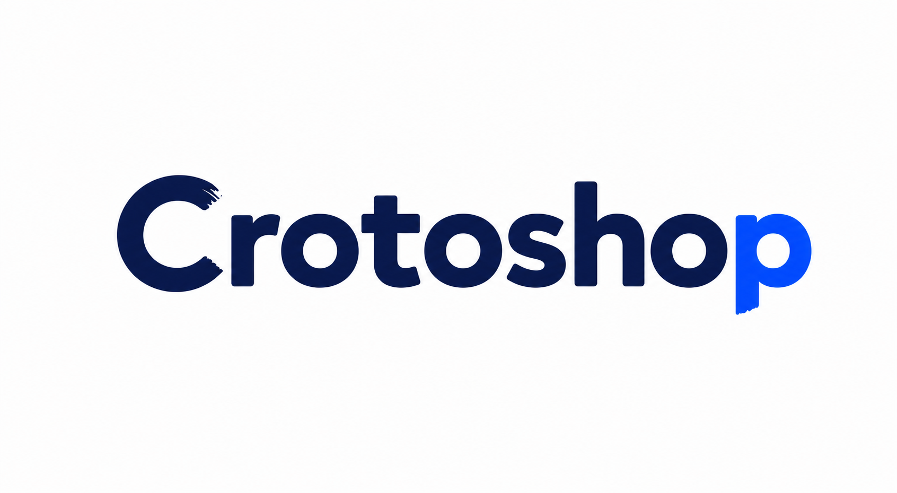

<p align="center">
  
</p>

<p align="center">
  Un editor híbrido de imágenes y vectores, rápido, local y pensado para trabajar de verdad.
</p>

<p align="center">
  <a href="https://github.com/GabrielHufschmid/crotoshop/actions/workflows/ci.yml"></a>
  
  
  
</p>

<p align="center">
  <a href="https://apps.gabi.com.ar/crotoshop/"><strong>Abrir la versión web</strong></a>
  ·
  <a href="./MacOs-crotoshop/README.md"><strong>Documentación de Desktop</strong></a>
  ·
  <a href="./docs/ARCHITECTURE.md"><strong>Arquitectura</strong></a>
</p>

## Qué es Crotoshop

Crotoshop nació como un editor raster liviano y terminó creciendo hacia un
espacio de trabajo híbrido: capas, máscaras y selecciones conviven con trazados
Bézier, formas editables, texto y operaciones vectoriales. La prioridad no es
copiar cada botón de una suite enorme, sino ofrecer un flujo ágil y preciso para
las tareas que más se repiten al preparar imágenes, piezas gráficas, logos y
contenido para pantalla.

El repositorio contiene dos aplicaciones:

| Variante | Ejecución | IA | Archivos |
| --- | --- | --- | --- |
| **Web** | React + Canvas/WebGL en el navegador | ONNX Runtime con WebGPU/WASM | Importación, descarga y proyectos locales |
| **Desktop** | Electron para macOS, con base preparada para Windows | Sidecar Python/ONNX local | Abrir, guardar, exportar y observar archivos nativamente |

Las imágenes no se envían a un servicio de Crotoshop. El procesamiento se hace
en el dispositivo; la versión web puede solicitar tipografías a Google Fonts
cuando el usuario las elige.

> Crotoshop es un proyecto independiente y no está afiliado ni respaldado por
> Adobe Inc. Photoshop e Illustrator son marcas de sus respectivos titulares.

## Capacidades principales

### Edición raster y selecciones

- Selección rectangular, elíptica, poligonal, Bézier, varita mágica y máscara IA.
- Combinación de selecciones, suavizado, feather, expansión y contracción.
- Transformación no destructiva durante la previsualización: mover, rotar y
  escalar con handles, proporciones y snapping.
- Crop reposicionable, redimensionable, rotatorio y capaz de extender el lienzo.
- Pincel, borrador, relleno, desenfoque, enfoque y refinado de texto/líneas.
- Pixel Stretch guiado por curvas y Warp Mesh orgánico en la aplicación Desktop.

### Vectores y tipografía

- Formas paramétricas, pluma Bézier y edición directa de nodos.
- Rellenos sólidos o degradados, trazo alineado, extremos, uniones y guiones.
- Trazados compuestos, simplificación, redondeo y operaciones Pathfinder.
- Importación SVG/PDF/EPS/AI como vector o raster; rasterización bajo demanda.
- Conversión de texto a curvas y vectorización de capas raster.
- Texto editable con preview en vivo, métricas tipográficas y fuentes locales o
  de Google Fonts.

### Capas, color y documentos

- Capas, grupos, máscaras, modos de fusión, bloqueos y etiquetas.
- Ajustes por capa acelerados por WebGL: brillo, contraste, saturación, gamma,
  hue, inversión y recoloreado por alfa.
- Paletas armónicas guardables, selector completo y cuentagotas con preview.
- Reglas, guías manuales, snapping a guías, centro y tercios.
- Múltiples documentos, historial, recuperación de sesión y mesas de trabajo.
- Proyectos `.crotoshop`, paletas `.crotopalette` y exportación PNG/JPEG/WEBP/SVG
  con resolución embebida cuando corresponde.

### IA local

- Remoción de fondo con refinado previo a la aplicación.
- Máscara semántica para seleccionar objetos completos.
- Relleno contextual sobre una selección en una capa independiente.
- El backend Desktop se inicia bajo demanda, valida dimensiones y buffers, y se
  apaga cuando queda inactivo.

## Inicio rápido

### Requisitos

- Node.js `22.12` o superior.
- npm `10` o superior.
- Para empaquetar el backend Desktop: Python 3 disponible como `python3`.

### Web

```bash
npm ci
npm run dev
```

Vite publica el entorno local en `http://localhost:5173/crotoshop/`.

```bash
npm run lint
npm test
npm run build
```

El script previo al build copia los assets de `@imgly/background-removal` a
`public/imgly-data/`. Son artefactos generados y no se versionan.

### Desktop

```bash
cd MacOs-crotoshop
npm ci
npm run dev
```

Los comandos de empaquetado, firma y backend están documentados en
[MacOs-crotoshop/README.md](./MacOs-crotoshop/README.md).

## Estructura del repositorio

```text
.
├── src/                    # Aplicación web, estado, UI y motores de edición
├── public/                 # Assets públicos reproducibles
├── scripts/                # Preparación de assets para la web
├── MacOs-crotoshop/
│   ├── src/                # Renderer Desktop y herramientas avanzadas
│   ├── electron/           # Main process, preload e integración nativa
│   ├── backend/            # Backend local de IA
│   ├── build/              # Icono y entitlements de macOS
│   └── scripts/            # Build, firma y verificación de artefactos
├── docs/ARCHITECTURE.md
├── CONTRIBUTING.md
└── SECURITY.md
```

La explicación de los límites entre UI, estado, motores, Electron e IA está en
[Arquitectura](./docs/ARCHITECTURE.md).

## Calidad y seguridad

Cada variante se valida con TypeScript, Oxlint, Vitest y un build de producción
en CI. Los formatos propios se parsean con validación de tipos, rangos y límites
de tamaño antes de reconstruir documentos o paletas.

Los binarios, modelos ONNX, entornos virtuales, builds, credenciales, proyectos
de usuario y automatizaciones privadas de deploy están excluidos de Git. Para
reportar una vulnerabilidad, consultá [SECURITY.md](./SECURITY.md).

## Contribuir

Los reportes claros y los PR acotados son bienvenidos. Antes de empezar, leé
[CONTRIBUTING.md](./CONTRIBUTING.md), donde están el flujo de trabajo, los gates
de calidad y las convenciones del proyecto.

## Estado y licencia

El proyecto está en desarrollo activo. La variante Desktop es el frente con
mayor cobertura funcional; la compilación para Windows está contemplada, pero
todavía necesita validación específica de plataforma.

Este repositorio se publica para mostrar y colaborar sobre el desarrollo, pero
por ahora no concede una licencia de código abierto. Salvo que se indique lo
contrario, el código permanece bajo copyright de su autor.
