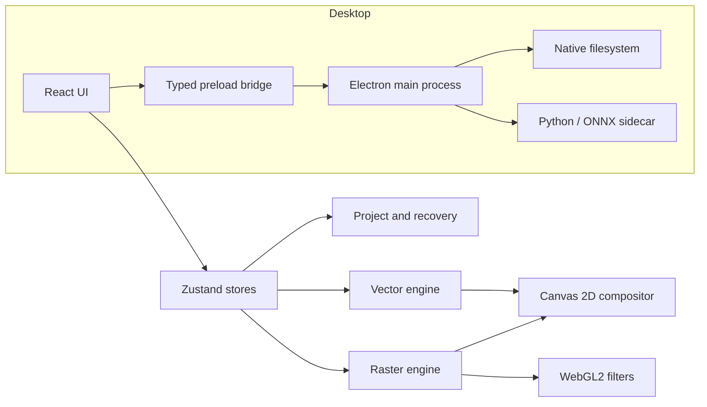

# Arquitectura de Crotoshop

Este documento describe las decisiones que sostienen las variantes Web y
Desktop. El objetivo es que una persona nueva pueda ubicar una responsabilidad,
seguir el flujo de datos y hacer cambios sin acoplar UI, estado y procesamiento.

## Vista general

La UI expresa intención; los stores coordinan el documento y el historial; los
motores realizan operaciones puras o acotadas sobre canvases y estructuras de
datos. La integración nativa se mantiene fuera del renderer.

## Modelo de documento

El documento vive en `editorStore.ts` y contiene dimensiones, capas, selección,
guías, mesas de trabajo y metadatos de edición. Una capa puede representar:

- píxeles raster sobre un `HTMLCanvasElement`;
- texto editable con métricas y estilo;
- vectores colocados o trazados editables;
- un grupo con composición aislada;
- un ajuste no destructivo.

Transformación, opacidad, visibilidad, modo de fusión, máscara y bloqueos son
propiedades de capa. Los canvases solo se hornean cuando una operación realmente
necesita materializar el resultado.

### Historial

Las mutaciones significativas crean snapshots descriptivos. Para evitar copiar
documentos completos en cada paso, el historial comparte superficies mientras
son inmutables y separa el canvas que va a modificarse. Desktop suma un
presupuesto de memoria y recorta estados antiguos cuando es necesario.

## Render raster

El compositor recorre la jerarquía de capas y produce la vista final:

1. obtiene la fuente raster, vectorial o tipográfica de cada capa;
2. aplica transformación e interpolación;
3. combina máscara, opacidad y modo de fusión;
4. procesa grupos en superficies aisladas;
5. ejecuta ajustes acelerados por WebGL2;
6. compone el resultado en Canvas 2D.

Las cachés se invalidan mediante versión de canvas y propiedades relevantes, no
por comparación costosa de píxeles.

## Selecciones y máscaras

Una selección se representa como una máscara alfa del tamaño del documento y,
cuando aplica, conserva además su forma paramétrica. Esto permite:

- combinar selecciones sin depender de geometría específica;
- usar la misma máscara para copiar, cortar, borrar, rellenar o transformar;
- dibujar marching ants sin mutar el documento;
- guardar canales de selección;
- convertir resultados de IA en selecciones comunes.

Las máscaras de capa siguen el mismo principio, pero permanecen asociadas a una
capa y se evalúan durante la composición.

## Sistema vectorial

Desktop mantiene formas, subtrazados y nodos Bézier en coordenadas locales de
capa. El estilo vectorial incluye relleno, degradado, trazo, alineación,
cap/join, patrón de guiones, opacidad y regla de relleno.

Las responsabilidades están separadas:

- `vectorPath.ts`: modelo, clonación, bounds y edición de nodos;
- `vectorPrimitives.ts`: rectángulos, elipses, triángulos y polígonos;
- `paperVector.ts`: simplificación y operaciones Pathfinder;
- `textToVector.ts`: conversión de glifos OpenType a curvas;
- `vectorize.ts`: trazado de una fuente raster;
- `VectorAppearanceEditor.tsx`: edición visual de apariencia.

La rasterización es explícita. Mientras la capa siga siendo vectorial, el
renderer conserva datos editables y vuelve a renderizar a la escala necesaria.

## Snapping y coordenadas

Las operaciones trabajan en coordenadas de documento y convierten a espacio de
capa solo en los límites del motor. Los candidatos de snapping incluyen guías,
bordes, centro y tercios. UI flotante y ventanas de herramientas tienen un motor
de snapping separado para no mezclar geometría del documento con geometría de
pantalla.

## Persistencia

### Proyectos

`.crotoshop` almacena estructura, propiedades y recursos del documento. El
parser valida versión, tipos, rangos, conteos y dimensiones antes de reconstruir
canvases. Desktop usa un contenedor binario con checksums para evitar el costo y
la expansión de Base64.

### Recuperación

La recuperación se guarda de forma asíncrona en IndexedDB. Se ejecuta fuera del
camino crítico de dibujo, reutiliza blobs cuando una capa no cambió y nunca debe
bloquear una operación del usuario.

## Límite Electron

El renderer se trata como contenido no privilegiado:

- `nodeIntegration: false`;
- `contextIsolation: true`;
- `sandbox: true`;
- API nativa explícita en `preload.cjs`;
- validación de rutas, buffers y dimensiones en el proceso principal;
- CSP en el documento empaquetado.

Los diálogos, watch de archivos, escritura y lectura ocurren en el main process.
La UI recibe datos serializables mediante IPC.

## Backend de IA

El sidecar Python carga ISNet con ONNX Runtime. Electron escribe RGBA crudo en
un directorio temporal, envía una orden JSON por `stdin` y recibe el estado por
`stdout`. Evitar PNG en esta frontera reduce CPU y memoria para imágenes grandes.

Controles principales:

- límites de dimensión y cantidad total de píxeles;
- longitud exacta del buffer RGBA;
- timeout y cancelación;
- directorios temporales únicos con limpieza garantizada;
- checksum del modelo durante el build;
- apagado por inactividad.

## Web y Desktop

Las dos variantes comparten conceptos y buena parte del diseño, pero hoy viven
como aplicaciones hermanas. Un cambio transversal debe revisarse en ambas; una
mejora exclusivamente nativa debe permanecer en `MacOs-crotoshop/`.

Antes de extraer un paquete compartido conviene confirmar que la abstracción
reduce duplicación real sin obligar al renderer web a conocer Electron o Python.

## Principios para extender el código

1. Mantener la intención de UI fuera de los motores.
2. Preferir coordenadas de documento en APIs públicas.
3. No mutar un canvas compartido por el historial.
4. Validar datos en el límite donde ingresan.
5. Conservar vectores y texto editables hasta que el usuario rasterice.
6. Medir antes de sumar cachés o complejidad.
7. Agregar tests en motores compartidos y recorridos con alta probabilidad de
   regresión.
